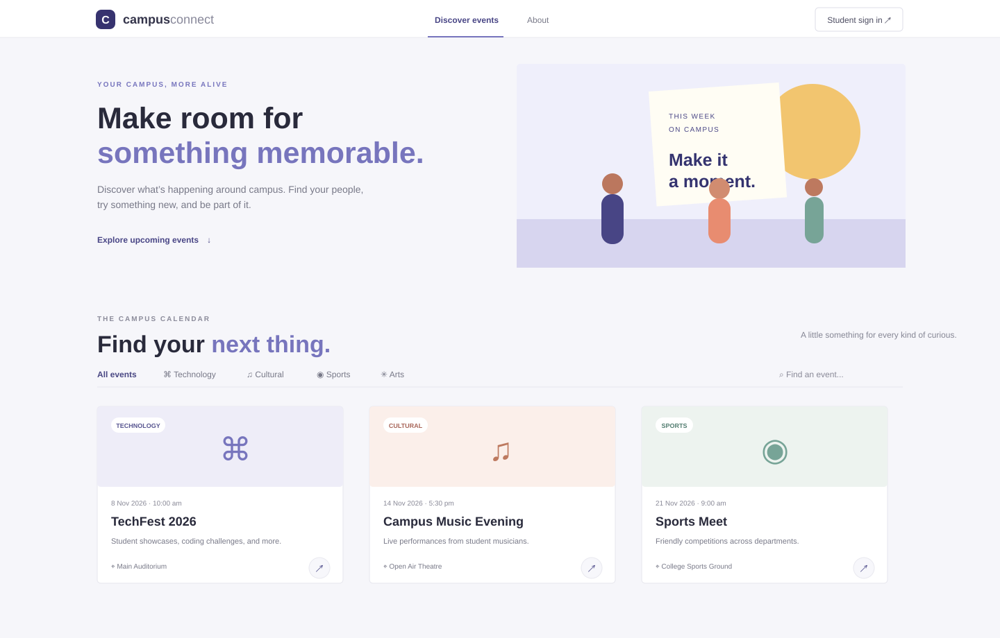
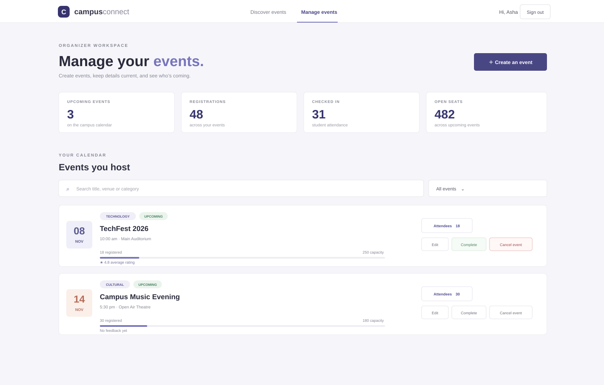

# Campus Connect — College Event Management

Campus Connect is a small college event management project built with React, Vite, Express, and SQLite. Students can find and register for campus events; organizers can manage events, check in attendees, and review feedback.

## Requirements

- Node.js 18 or newer
- No database server setup is required. SQLite stores the database in a local file.

## Setup

1. From the project root, install the packages:

   ```bash
   npm run install:all
   ```

2. Start the API and frontend together:

   ```bash
   npm run dev
   ```

3. Open **http://localhost:5173**. The API runs at **http://localhost:4000**; its database connection can be checked at **http://localhost:4000/api/health**.

Keep the terminal open while using the site. On first start, the backend creates `backend/database.sqlite`, adds sample events, and prepares the development demo accounts. If the site says it cannot reach the event service, check that both servers are running.

## Demo walkthrough

The development database includes sample events and two demo accounts:

| Role | Email | Password |
| --- | --- | --- |
| Student | `student@campus.edu` | `CampusStudent123!` |
| Organizer | `organizer@campus.edu` | `CampusOrganizer123!` |

These shared accounts are for local demos only. The backend creates them only when `NODE_ENV` is not `production`. Remove the demo accounts and use a fresh database before any public deployment.

To demo both roles:

1. Sign in as the demo student. **My registrations** includes a completed showcase for feedback and upcoming events for calendar downloads.
2. Download an `.ics` invite from an upcoming registration. You can also register for an event from **Discover events**.
3. Sign out and sign in as the demo organizer. The demo account owns a sample upcoming event with an attendee, plus a completed event to review. Create another event and review the summary cards.
4. The completed showcase starts with sample student feedback. Edit it as the student, then sign in as the organizer to see the event’s average rating.

## Screen previews

These previews show the main student and organizer screens used in a project presentation.





## Try the organizer flow

1. Sign out of any existing account.
2. Choose **Sign in → Create an account**.
3. Set **Account type** to **Organizer — create and manage events** and complete sign-up.
4. Open **Manage events** to create, edit, or cancel events, search and filter your calendar, and review attendee lists.
5. While an event is upcoming, open its attendee list and mark students present as they arrive. Search the list or download it as a CSV file with attendance status.
6. After the event time, use **Complete** to move it to completed events.

Existing student accounts stay student accounts. Create a separate organizer account with a different email to use the organizer dashboard.

## Features

- Upcoming event list with sample data
- Category filtering and text search
- Event details with date, time, venue, organizer, and capacity
- Responsive layout for desktop and mobile
- SQLite schema and Express endpoints for listing and viewing events
- Student sign-up and sign-in with hashed passwords
- Event registration with deadline, duplicate, and capacity checks
- Student “My registrations” page with cancellation
- Organizer account type during sign-up
- Organizer dashboard with upcoming-event and attendee totals
- Create, edit, and cancel organizer-owned events
- Attendee list with student names, emails, and registration dates
- Organizer event search and status filters
- Mark past events completed
- Attendee search and CSV roster download
- Attendee check-in with a live count and attendance included in CSV export
- Student profile name editing
- Post-event ratings and comments from registered students
- Organizer event ratings summary
- Calendar invite download for student registrations
- Demo walkthrough and screen previews
- Role and ownership checks on organizer API actions

## Existing setup

If the project is already running, restart both servers from the project root with `npm run dev`. Existing SQLite data is preserved; the backend adds new registration fields and the feedback table when it starts.
